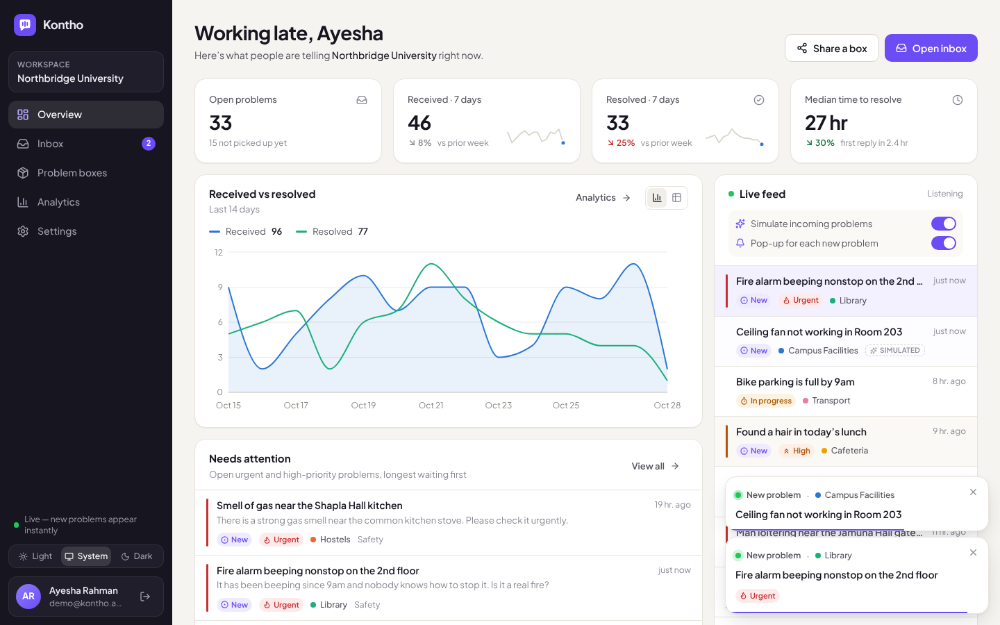
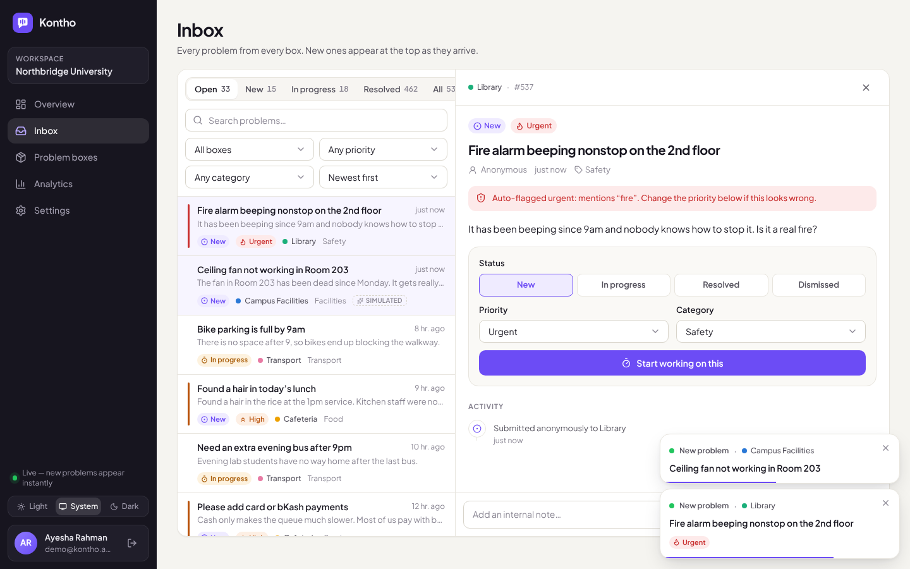
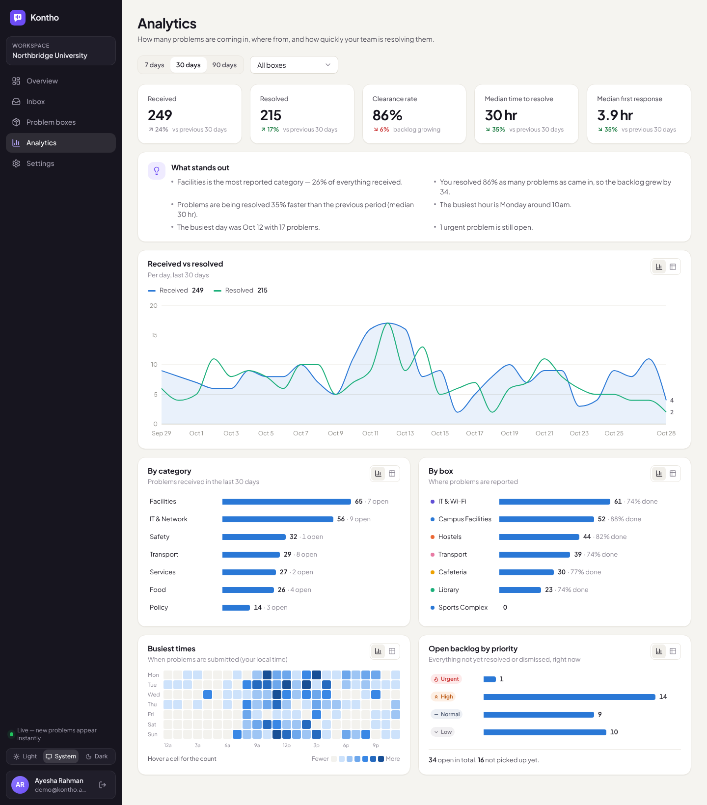
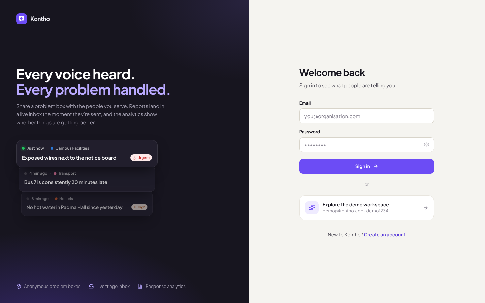
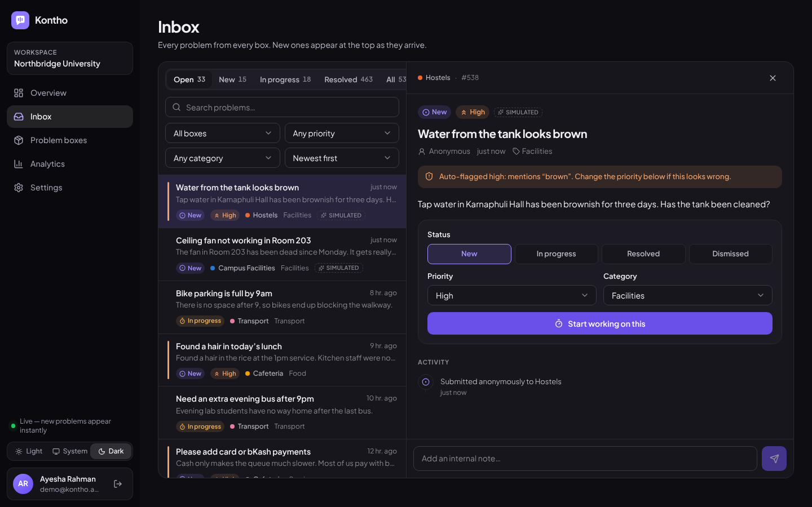
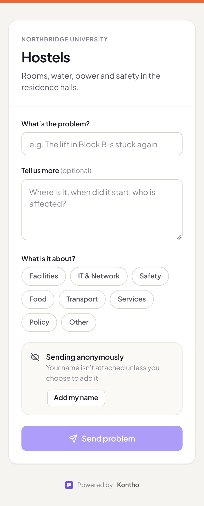

# Kontho — problem boxes, a live inbox and analytics

Kontho lets an organisation put up **problem boxes**: shareable links (or QR codes on a notice board) where anyone can report a problem, anonymously by default. Every report **pops up live** in the team's dashboard, gets triaged in an inbox, and feeds the **analytics** that show whether things are getting better.



## Try it in two minutes

Requires **Node.js 22.13 or newer** (uses the built-in SQLite module, so there is no database to install).

```bash
npm install
```

```bash
npm run dev
```

Open http://localhost:5173 and click **Explore the demo workspace** (or sign in with `demo@kontho.app` / `demo1234`). The demo account comes with ~2½ months of history.

To see problems pop up for real: on **Problem boxes**, click **Open page** on any box, submit a problem in that tab, and watch it land in the dashboard. Leave **Simulate incoming problems** on to get a steady stream of realistic sample reports (marked *Simulated*).

## What's in it

| Screen | What it does |
| --- | --- |
| **Sign in / sign up** | Email + password accounts. Passwords are hashed with scrypt; sessions are HTTP-only cookies. |
| **Overview** | Open backlog, weekly received/resolved with trend, median time to resolve, a *Needs attention* list, and a **live feed** where new problems animate in. |
| **Inbox** | Every problem with status tabs, search and filters (box, priority, category, sort). Open one to change status/priority/category, read its timeline and leave internal notes. New arrivals slide in at the top. |
| **Problem boxes** | Create, edit, close or delete boxes. Each has a public link and a downloadable **QR code**. |
| **Public box page** (`/b/<slug>`) | The mobile-friendly form people use to report a problem: no account needed, anonymous unless they add their name. |
| **Analytics** | Received vs resolved over time, clearance rate, median resolution and first-response times (all vs the previous period), breakdowns by category and box, a *busiest times* heatmap, backlog by priority and plain-language takeaways. Every chart has a table view. |
| **Settings** | Profile, password, pop-up notifications, simulated feed and light/dark theme. |

Also:
- **Pop-ups**: each new problem shows a toast (click to open it), bumps the Inbox badge and the tab title count.
- **Auto-triage**: submissions mentioning things like *fire, gas, exposed wire, harassment* are flagged **urgent**, and *outage, no water, leak* are flagged **high**. The reason is shown on the problem so a person can overrule it (`server/triage.ts`).
- **Dark mode**, responsive down to phone width, keyboard-accessible controls.

| | |
| --- | --- |
|  |  |
|  |  |



## Running in production

```bash
npm run build
```

```bash
npm start
```

`npm start` serves the built app and the API together on one port (default `8787`).

| Variable | Default | Meaning |
| --- | --- | --- |
| `PORT` | `8787` | HTTP port |
| `DATABASE_PATH` | `data/kontho.db` | SQLite file (created on first run) |
| `SEED_DEMO` | `true` | Set to `false` to skip creating the shared demo account |
| `TRUST_PROXY` | off | Set to `1` behind a reverse proxy so rate limits and secure cookies use `X-Forwarded-For` / `X-Forwarded-Proto` |

Run it behind HTTPS in production (cookies are marked `Secure` automatically on HTTPS). The demo account's password can't be changed, but anyone who signs in to it can edit its boxes, so turn it off with `SEED_DEMO=false` on a real deployment. `npm run reset-db` deletes the local database.

## How it's built

```
server/            Node + Hono API
  index.ts         entry: API, static files, demo seeding
  app.ts           routes (auth, boxes, problems, analytics, public box, live stream)
  auth.ts          scrypt hashing, sessions, CSRF guard, rate limiting
  db.ts            SQLite schema + queries (node:sqlite)
  live.ts          Server-Sent Events hub + simulated feed
  analytics.ts     KPI and chart aggregation (in the viewer's timezone)
  samples.ts       sample boxes/problems for the demo and "Explore with sample data"
  triage.ts        keyword auto-prioritisation
shared/types.ts    types shared by server and client
src/               React 19 + Vite + Tailwind CSS 4 dashboard
  pages/           Login, Signup, Overview, Inbox, Boxes, Analytics, Settings, PublicBox
  components/      shell, badges, problem detail, charts (Recharts + hand-built bars/heatmap)
  lib/             API client, auth/live/theme contexts, formatting
```

- **Live updates** use Server-Sent Events (`GET /api/stream`): one connection per tab, no extra infrastructure.
- **Security**: scrypt password hashes, random session tokens stored hashed, `HttpOnly` + `SameSite=Lax` cookies, JSON-only mutations (blocks CSRF), every query scoped to the signed-in user, rate limits on sign-in, sign-up and public submissions, and a honeypot field against form bots.
- **Charts** follow a validated colour-blind-safe palette; status and priority are always shown with an icon and label, never colour alone.
- The API is written with [Hono](https://hono.dev), which also runs on Cloudflare Workers, so moving to Workers + D1 later mostly means swapping `server/db.ts`.

### Useful scripts

| Command | |
| --- | --- |
| `npm run dev` | API (auto-restart) + Vite dev server with hot reload on :5173 |
| `npm run typecheck` | TypeScript check for server and client |
| `npm run build` | Production build into `dist/` |
| `npm start` | Serve `dist/` + API |
