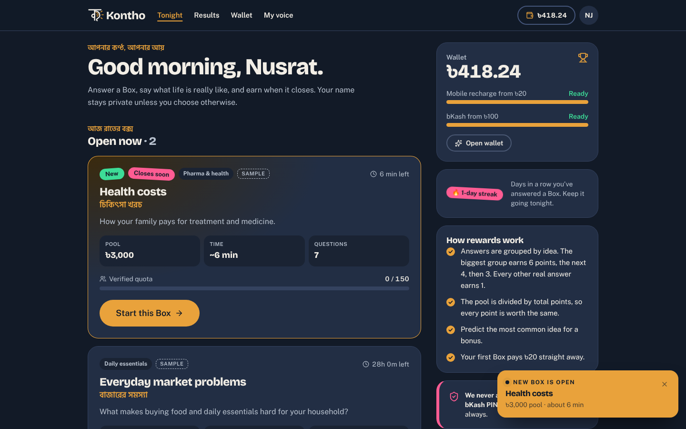
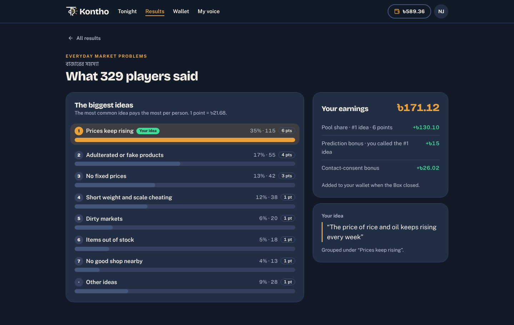
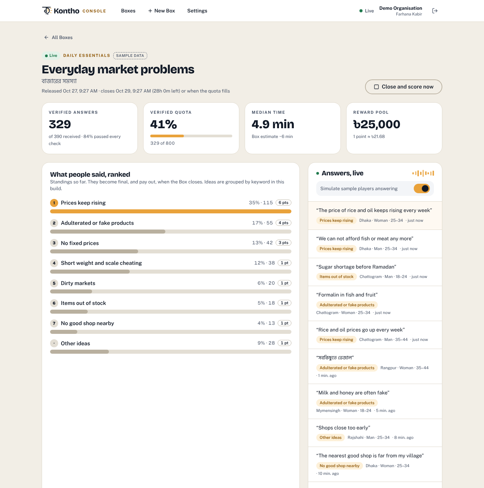
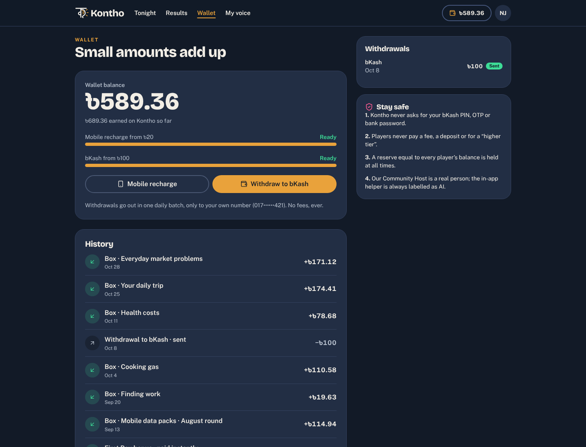
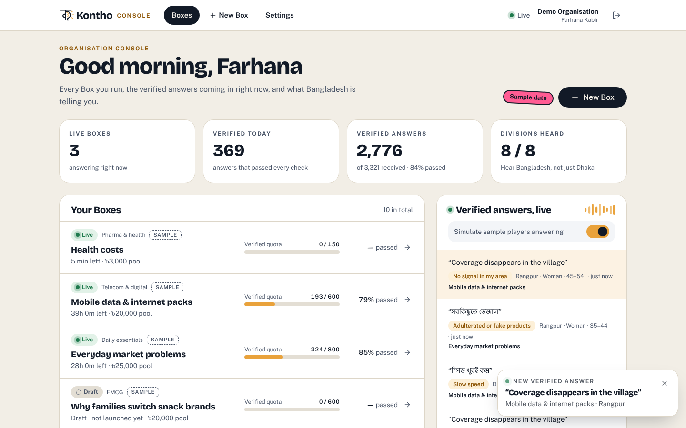
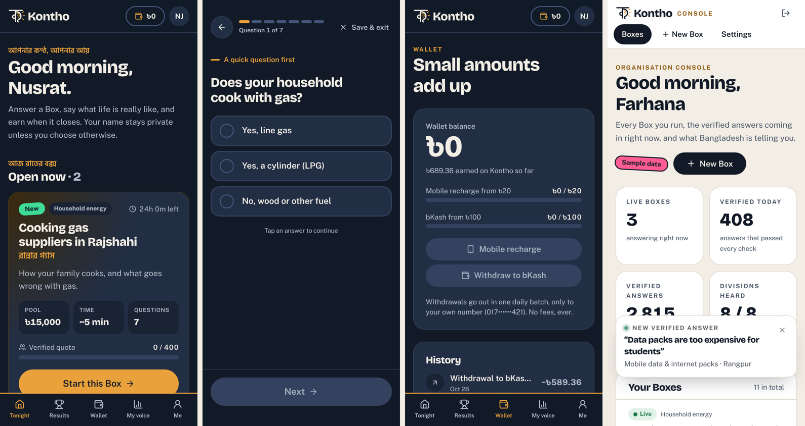

# Kontho (কণ্ঠ) — player app and organisation console

**Real voices, verified. · আপনার কণ্ঠ, আপনার আয়**

One sign-in, two dashboards, in the Kontho design system (Ink, Amber and Cream; Bricolage Grotesque, Public Sans and Hind Siliguri; the ক mark):

- **Players** (Ink theme) see new **Boxes pop up** the moment they open, answer them one question per screen, and get their results, rank points and wallet credit when the Box closes. They withdraw from ৳20 as mobile recharge or from ৳100 to bKash.
- **Organisations** (Cream theme) launch Boxes and watch **verified answers pop in live**. Each Box has a report with ranked idea themes, quotes, measured questions, the verification funnel and quotas by division, gender and age.



## Try it on your computer

You need **Node.js 22.13 or newer**. Check with `node --version`; if it's missing or older, install the LTS version from https://nodejs.org.

1. Download this repository: on GitHub, click **Code → Download ZIP** and unzip it. Or clone it:

```bash
git clone -b claude/magical-shannon-yu3a97 https://github.com/cohenwroteasong/ProblemBox.git
```

2. In Terminal, go into the folder. Type `cd ` with a space, drag the folder onto the Terminal window, and press Enter.

3. Install and start:

```bash
npm install
```

```bash
npm run dev
```

4. Open **http://localhost:5173** and pick a demo:

| Demo | Email | Password |
| --- | --- | --- |
| Player | `player@kontho.app` | `demo1234` |
| Organisation | `org@kontho.app` | `demo1234` |

Open both in two browser windows to see the whole loop. The organisation launches a Box → it pops up for the player → the player answers → the answer appears in the organisation's live feed → the organisation clicks **Close and score now** → the player gets a "Results are in" pop-up and the money lands in their wallet.

While a dashboard is open, **Simulate activity** keeps things moving. Sample players answer live Boxes, and a demo release slot opens a new Box for players every few minutes. Everything it creates is marked *Sample* or *simulated*; switch it off in Settings.

## How it follows the reward rules

From konthoglobal.com/reward-rules:

- Every Box has a reward pool. Verified idea answers are grouped by theme. The largest group earns **6 points**, the second **4**, the third **3**, and every other real answer **1**. Answers that fail checks earn **0**.
- The pool is divided by the total points, so every point in a Box is worth the same. Earnings land in the wallet when the Box closes.
- The first Box pays **৳20** straight away. Withdrawals start at **৳20** (recharge) or **৳100** (bKash), with no fees.
- Bonus amounts are still with counsel. This build uses the product demo's sample figures: **+৳15** for predicting the #1 idea, and **+20%** for opting in to share contact details. Both are constants in `shared/types.ts`.

Each Box has the five question roles: **screener** (routes people), **measured** (never scored), **idea** (scored by rank), a **hidden check**, and a **prediction**. Answers are verified on arrival: screener fit, speed, the hidden check, effort, copying and duplicate devices.

> Ideas are grouped by **keyword matching** in this build (`server/templates.ts`), so it runs without any outside service. The production app groups ideas by meaning with AI, and an analyst signs off the report.

## Screens

| Player (Ink) | Organisation (Cream) |
| --- | --- |
|  |  |
|  |  |



## What's where

```
server/            Node + Hono API, SQLite (built into Node), Server-Sent Events
  app.ts           routes: auth, player, organisation, live stream
  scoring.ts       verification on submit; rank points and payouts on close
  templates.ts     ready-made five-part Boxes, idea themes and keyword grouping
  sim.ts           sample players, the demo release slot, the close-and-pay ticker
  seed.ts          the two demo accounts and their history
  auth.ts, db.ts   sessions, password hashing, schema
shared/types.ts    types and reward constants used by both sides
src/               React + Vite + Tailwind CSS
  pages/player/    Tonight, Box (answering), Results, Wallet, My voice, Me
  pages/org/       Boxes overview, Box report and draft editor, New Box, Settings
  pages/auth/      Sign in, Sign up (player or organisation)
public/brand/      Kontho logo files from the website kit
```

**Security:** passwords are hashed with scrypt, and session tokens are stored hashed in HttpOnly SameSite cookies. Every query is scoped to the signed-in account and its role. Sign-in and sign-up are rate-limited, and mutations must be JSON, which blocks CSRF. The hidden check's correct answer is never sent to players.

## Running for real

```bash
npm run build
```

```bash
npm start
```

`npm start` serves the app and API on one port (default 8787). Settings:

| Variable | Default | Meaning |
| --- | --- | --- |
| `PORT` | `8787` | HTTP port |
| `DATABASE_PATH` | `data/kontho.db` | SQLite file |
| `SEED_DEMO` | `true` | `false` skips the demo accounts and the demo release slot |
| `TRUST_PROXY` | off | `1` behind a reverse proxy, so rate limits and secure cookies use its headers |

Turn the demo accounts off (`SEED_DEMO=false`) on any public deployment, and serve it over HTTPS. `npm run reset-db` deletes the local database.

## Still to do

- **Bangla copy needs a native-speaker check**, as with the rest of the Kontho drafts. Box titles and key lines are in Bangla; full Bangla localisation of the interface comes next.
- Voice answers, OTP-verified phone numbers, the real bKash disbursement batch, AI idea grouping, the fraud review queue and analyst sign-off are not in this build.
- Bonus amounts and dispute rules wait on counsel, as on the reward rules page.
